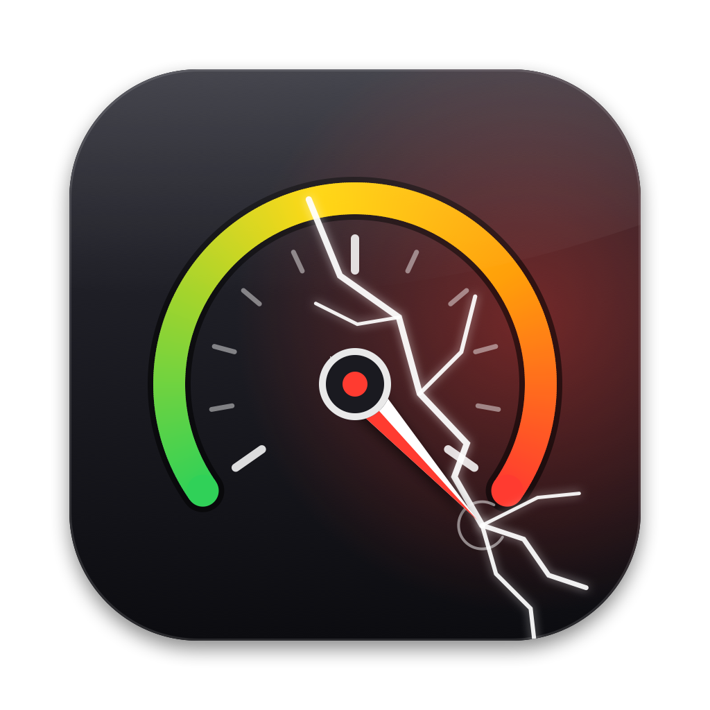

<p align="center">
  
</p>

<h1 align="center">Cracked</h1>

<p align="center">
  <strong>A menu bar system monitor for Macs that are absolutely cooking.</strong><br>
  It catches runaway processes, calls out apps you forgot to quit three weeks ago,<br>
  and keeps a trophy cabinet of your most unhinged system stats.
</p>

<p align="center">
  
  
  
  
  <a href="https://github.com/bangarang/cracked/releases/latest"></a>
</p>

---

> **cracked** /krakt/ *adj.*
> 1. *Cycling:* completely blown up halfway up a climb.
> 2. *Drums:* the snap of a perfectly hit snare.
> 3. *Slang:* absurdly, unreasonably impressive. As in *"262 browser renderer processes? That's cracked."*

Your Mac is probably all three. Cracked sits in the menu bar and lets you know. It also keeps tabs on your coding agents, in Claude Code and Paseo.

## Why

Activity Monitor tells you what's happening **right now**. It won't tell you that a browser renderer has been pinned at 114% CPU since Tuesday, that Warp has been up for 22 days, or that you just set a personal best of 161 open tabs.

Cracked does, at a glance, from one icon.

## Features

### 🚦 A menu bar icon that has a mood
A gauge that stays calm until things get spicy:

| State | Trigger |
| --- | --- |
| ⚪️ **Chill** | Everything's fine. Probably. |
| 🟡 **Warning** | An app is over your CPU threshold, load average is above 8, or macOS reports memory pressure |
| 🔴 **Cracked** | An app is above 100% CPU, load average is above 20, or memory pressure is critical |

### 🔥 CPU hogs, one click from dead
Click the icon to see which apps are eating your cores right now, with their icons and clean names. Each row has a **Kill** button.

### 🧟 Worth a Restart
Not just "apps that are old". Messages and Slack are *meant* to run forever. Cracked flags an app only when it has been up for days **and** is using a lot of memory across all of its helper processes. That's the browser with 170 renderers sitting on 65 GB, not the notes app quietly using 165 MB.

Each row says why it's there (`Comet  65 GB · 10d`) and has a **Restart** button that quits the app gracefully and relaunches it. Right-click a row to **snooze it for a week** or **never suggest it again**. Widget extensions, Spotlight indexers and other background bits macOS starts at login are never counted.

### 📊 Tracked apps, Strava-style
Cracked counts what you're actually juggling and logs every **PR**:

- **Browser tabs**: Comet, Arc, Chrome
- **Cursor windows**
- **Paseo agents**
- **Claude Code sessions** (outside Paseo)
- **Warp tabs**

Every app gets a history chart and a PR badge with the date you set it. Beat your record of 161 tabs and you have a new PR. We're not judging. (We're judging a little.)

### 🦙 Local models
Models loaded in Ollama take tens of gigabytes and barely show up in process stats, because their GPU memory is wired. Cracked asks Ollama directly (`/api/ps`, on this Mac only) and lists each loaded model with its memory and when Ollama will unload it, plus an **Unload** button that frees it right away. The section header shows how much of your RAM the models are holding, in yellow or red when macOS reports memory pressure.

### 🤖 Mission control for your coding agents
Running seven Claude Code sessions across five terminals? Cracked keeps track of them for you.

- **Agent inbox:** every session shows up under **Agents** as *working*, *done* or *needs input*, with the permission it's waiting on. Sessions that are blocked or finished put a count next to the menu bar icon. Click a session to bring its terminal to the front.
- **Terminal sessions, no setup:** Claude Code and OpenCode running in a terminal outside Paseo show up too. Claude Code sessions get their live status (*working*, *needs input*, *done*) and the same title as their terminal tab, read from the files Claude Code keeps in `~/.claude`. Click one to jump to its exact tab in Ghostty, iTerm2 or Terminal (macOS asks once to let Cracked control it). Other terminals are brought to the front.
- **Needs You:** agents that are blocked, errored or finished get their own section at the top of the menu.
- **Paseo agents, no setup:** if you use [Paseo](https://paseo.sh), its agents (Claude, OpenCode and the rest) show up under **Agents** too, with their titles, including when one is waiting for permission or has hit an error. Cracked reads Paseo's local state from `~/.paseo` (or `$PASEO_HOME`). Clicking one opens it in Paseo, and a Claude Code session that Paseo is running is listed only once.
- **Optional notifications** when an agent finishes or gets stuck. Click one to jump straight to that session.
- **MCP server:** agents can call `system_status`, `list_agent_sessions` and `get_records`, and, with your approval, `restart_app` or `snooze_app`. Restarts only work on apps already listed under Worth a Restart.
- **Load warnings:** when your Mac is struggling, new sessions are told so automatically ("load 46 on 16 cores · Xcode 140%"), so agents run builds one at a time instead of piling on.

Connect it from **Settings → Claude Code**, or from a terminal:

```bash
/Applications/Cracked.app/Contents/MacOS/Cracked setup     # hooks + MCP server
/Applications/Cracked.app/Contents/MacOS/Cracked status    # what's going on right now
```

Setup adds hooks to `~/.claude/settings.json` (it backs up the original first and leaves your other settings alone) and registers the MCP server with `claude mcp add`. `Cracked uninstall` removes both.

### 💡 SidePulse lights
Got a [SidePulse](https://sidepulse.io) Pro (SD card) or Dot (USB-C)? Cracked lights it up with your agents, from the same list as the menu, with no SidePulse software running:

| Lights | When |
| --- | --- |
| Amber pulse | An agent needs your input or hit an error |
| Cyan roll | An agent is working |
| Solid cyan | An agent finished, until you open Cracked's menu (or 20 minutes pass) |
| Dim pulse | Nothing going on |

Cracked writes the device's `LEDS.LED` only when the state changes, fades the lights out when your Mac sleeps, and keeps the Pro's SD card awake. It also keeps the Pro mounted when macOS would eject it: an SD card that reappears while the Mac is locked (after a hibernate wake, say) gets ejected by macOS, and Cracked refuses that eject and remounts the card once you unlock. Only SidePulse cards are kept, and you can switch this off to eject the Pro from Finder. A Dot is driven through its drive, or over USB when the drive can't be written (USB storage off, or a policy that makes USB drives read-only). **Settings → SidePulse** also checks for firmware updates, verifies the package's checksums, and installs it by copying `FIRMWARE.BIN` to the device, the way SidePulse does. Turn the lights off or set the brightness there too. A Dot needs its USB storage on, so it mounts as a drive. While SidePulse's own background service is running, Cracked leaves the lights to it.

### 🏆 All-Time Records & the Hall of Shame
The **Records & Stats** window brings it all together:

- **Live system stats**: load, memory, process count
- **24-hour trend charts** for load average and memory, drawn with Swift Charts
- **All-Time Records**: highest CPU spike, most processes from a single app, most processes system-wide, and peak tabs, windows and sessions
- **Hall of Shame**: the five worst offenders by sustained CPU

### ⚙️ Tune it to your chaos
Set the CPU alert threshold, when to suggest a restart (days running and GB used), the poll interval and the alert cooldown, manage your snoozed and ignored apps, and turn on launch at login.

## Privacy

Cracked is **100% local**. No accounts and no analytics. It talks to Ollama's API on your own machine, only while Ollama is running, and goes online only when you click **Check for firmware updates** for a SidePulse, to read SidePulse's releases on GitHub. SidePulse lights are driven by writing a file to the device. Snapshots live in a SQLite database on your Mac and are automatically downsampled: per-minute for 24 hours, then per-hour for 30 days, then daily. A year of history takes up almost nothing.

## Install

### Download

**[⬇︎ Download Cracked for Mac](https://github.com/bangarang/cracked/releases/latest/download/Cracked.dmg)** (Apple Silicon, macOS 14 Sonoma or later)

1. Open the DMG and drag **Cracked** into **Applications**.
2. Open Cracked from Applications. macOS will say *"Apple could not verify Cracked is free of malware"*, because this build isn't notarized by Apple yet. Click **Done**.
3. Open **System Settings → Privacy & Security**, scroll down to *"Cracked was blocked"* and click **Open Anyway**, then confirm.

You only do this once. Look for the gauge in your menu bar: Cracked runs as a menu bar–only app, so it has no Dock icon.

<details>
<summary>Prefer the terminal?</summary>

```bash
xattr -dr com.apple.quarantine /Applications/Cracked.app
open /Applications/Cracked.app
```
</details>

### Build from source

**Requirements:** macOS 14 Sonoma or later, Xcode 26+, and [XcodeGen](https://github.com/yonaskolb/XcodeGen).

```bash
git clone https://github.com/bangarang/cracked.git
cd cracked
brew install xcodegen
xcodegen generate

xcodebuild -project Cracked.xcodeproj -scheme Cracked -configuration Release \
  -derivedDataPath build build

cp -R build/Build/Products/Release/Cracked.app /Applications/
open /Applications/Cracked.app
```

> **Tip:** if `xcodebuild` complains about Command Line Tools, point it at Xcode with
> `sudo xcode-select -s /Applications/Xcode.app`.

No Xcode? `scripts/build-dmg.sh` builds the app and a DMG with just the Command Line Tools. Set `SIGN_IDENTITY` and `NOTARY_PROFILE` to sign and notarize it.

## Under the hood

```
┌───────────────────────────────────────────────┐
│  UI          SwiftUI · MenuBarExtra · Charts  │
├───────────────────────────────────────────────┤
│  Monitor     ProcessMonitor → AlertEngine     │
│                            → RecordTracker    │
├───────────────────────────────────────────────┤
│  Data        SQLite via GRDB · UserDefaults   │
└───────────────────────────────────────────────┘
```

- **`ProcessMonitor`** polls `ps`, `sysctl` and `vm_stat` off the main thread every few seconds
- **`AlertEngine`** applies the CPU, staleness and load thresholds, with per-process cooldowns
- **`RecordTracker`** notices when you've done something legendary and writes it down
- **`DatabaseManager`** runs GRDB migrations, stores snapshots and handles downsampling
- **`AgentInbox`** turns Claude Code hook events into session state, stored as one small JSON file per session
- **`TerminalAgents`** finds Claude Code and OpenCode processes outside Paseo, reads Claude Code's own session status, and focuses the right terminal tab
- **`LocalModels`** reads Ollama's loaded models and macOS memory pressure
- **`PaseoAgents`** maps the Paseo daemon's agent records (`~/.paseo/agents/*/*.json`) onto the same model, and **`AgentFeed`** merges all three sources
- **`MCPServer`** is a small hand-written MCP server over stdio, with no extra dependencies. It runs from the same binary: `Cracked mcp`

The project is generated from [`project.yml`](project.yml). Run the tests with:

```bash
xcodebuild test -project Cracked.xcodeproj -scheme Cracked
```

## Roadmap

- [ ] Per-app threshold overrides
- [ ] Opt-in auto-kill for repeat offenders
- [ ] Signed and notarized release builds
- [ ] App Store release

## Credits

The SidePulse animations, device detection and `LEDS.LED` format come from SidePulse's open-source tools ([inteliwear/sidepulse](https://github.com/inteliwear/sidepulse), MIT). See [`THIRD_PARTY_NOTICES.md`](THIRD_PARTY_NOTICES.md).

---

<p align="center"><sub>Built by <a href="https://github.com/bangarang">bangarang</a> for Macs with 161 tabs open.</sub></p>
